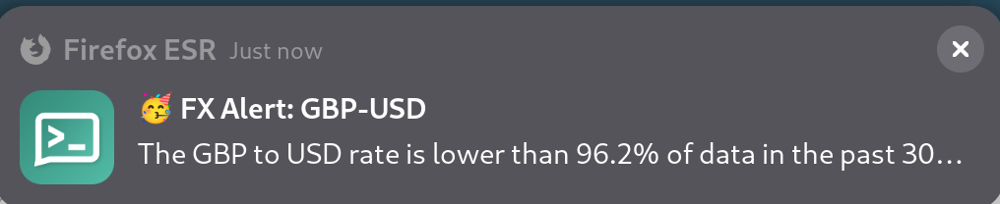
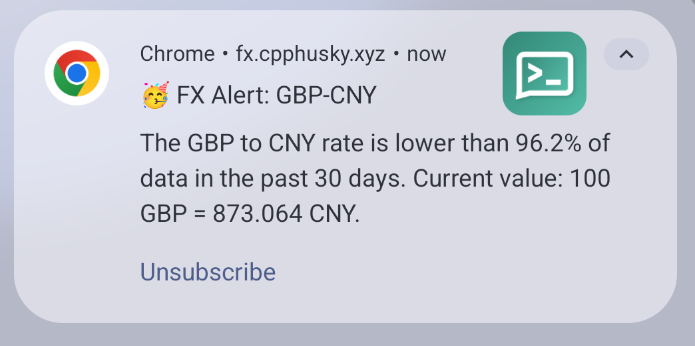
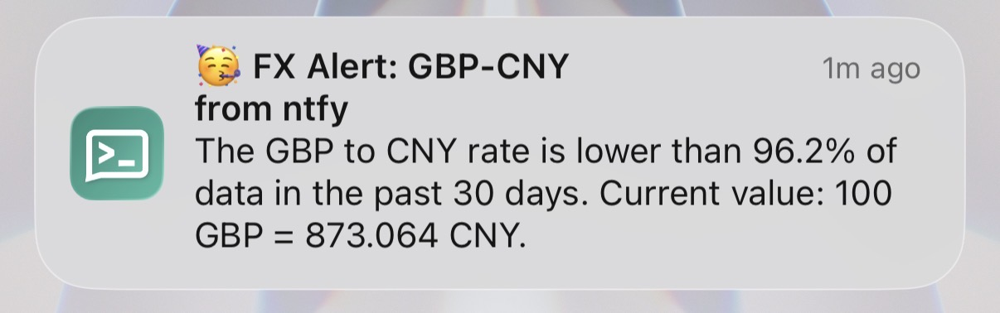

# FX Logger

Want to travel around the world? Or living abroad?

You may care about the best time to exchange your money. And when it comes, you want to be notified instantly?

After moving to Japan, I spent a lot of time to watch the JPY:CNY exchange rate, attempting to find a lower rate and exchange my money.

But later I got bored to that job, so I wrote this program, `fx-logger` to help me watch the history data, and decide when to make foreign exchange (FX).

You can feel free to [use this binary in the local machine](#usage), or subscribe it with [ntfy](https://ntfy.sh) App [from my self-hosted server](#from-my-ntfy-server).

Please note that this project is **NOT intended for investment**. It just analyses history data and tells you current rate is better than a few days ago, but it doesn't predict the future.

## How it works

[Open Exchange Rates](https://openexchangerates.org/) provides a simple API with live FX rates. On the free plan, an account can get hourly updated FX rates with at most 1000 queries per month. It's enough for us if we query once an hour.

`fx-logger` fetches the latest FX rates from it, and stores them in a [PostgreSQL](https://www.postgresql.org/) database. See [Database](#database) for more information.

After accumulating enough history data, we can use `fx-logger` to compare the latest rate (just regard it as "current rate") with history rates. For example, [my server](#from-my-ntfy-server) uses 30 days data with threshold 95% for all pairs of currencies. So if the current rate is lower than the 95% of data in the past 30 days, you would get notified.

## Install

You can install it from [crates.io](https://crates.io) with [Cargo](https://doc.rust-lang.org/stable/cargo/).

```sh
cargo install fx-logger
```

## Database

You need to [install PostgreSQL](https://www.postgresql.org/download). Or using [Docker image](https://hub.docker.com/hardened-images/catalog/dhi/postgres) alternatively.

Create a new database with any name you want, then import the [DDL file](./sql/ddl.sql).

From now on you can [connect it from `fx-logger`](#fetch).

## Usage

`fx-logger` has two subcommands except `help`.

### `fetch`

Use `fetch` to get the latest rates from Open Exchange Rates, and then store it into PostgreSQL.

You must set the following environment variables:
- `OPEN_EXCHANGE_RATE_APP_ID`. Just create it in [Dashboard](https://openexchangerates.org/account/app-ids).
- `FX_DATABASE_URL`. You need to [prepare your database](#database) at first, and use [PostgreSQL connection strings](https://www.postgresql.org/docs/current/libpq-connect.html#LIBPQ-CONNSTRING) here.

Because the open exchange rates updates once an hour, the best way to follow the latest data is to set a scheduled task, for example, using [cron](https://man.archlinux.org/man/crontab.5):

```crontab
1 * * * * . ${HOME}/.profile && ${HOME}/.cargo/bin/fx-logger fetch
```

It's recommended to run the task in the second minute of each hour, because the upstream data could delay in dozens of seconds.

### `get`

Use `get` to get the latest FX rates from database. **`get` doesn't fetch the API or edit the SQL records**.

You must set the `FX_DATABASE_URL`.

The following options are supported (the currency names must be uppercase [ISO 4217 currency codes](https://en.wikipedia.org/wiki/ISO_4217#List_of_ISO_4217_currency_codes)):

- `-b, --base`. The default base currency is `USD`. `fx-logger` will evaluate how much it takes in the `--output` currencies to afford 100 `--base` currency.
- `-o, --output`. A comma-separated list of currencies. By default `fx-logger` will output all currencies.
- `-s, --output-style`. The default value is `terminal` for human-readable output. You can choose another style like `waybar`, `ntfy`, etc, to [integrate with other tools](#integrate-with-other-tools).
- `--history-direction`. Can be `high` or `low` depending on what you want. If you want the `--output` currencies to become cheaper, use `high`.
- `--history-percent`. The threshold of **alert** (in percentage). For different `--output-style` the form of **alert** can be different too.
- `--history-days`. How many days of FX rates `fx-logger` should use for comparison.
- `-c, --config`. You can make a TOML file and write you commonly used settings in it, then use it with `--config`, like this:
```toml
base="CNY"
output=["JPY","USD"]
history_direction="high"
history_percent=95
history_days=30
```

Here is an example of `terminal` style output:
```
$ fx-logger -b CNY -o USD,JPY --history-direction low --history-percent 80 --history-days 30
100 CNY (in recent 30 days):
  USD: 14.982 (667.480)  ↓ than 82.6%
  JPY: 2375.228 (4.210)  ↓ than 36.4%
```

Notice that `terminal` doesn't output any **alert**.

#### `--suppress-equal` (`ntfy` style only)

The cash rate will keep flat because of FX market closure on weekends and festivals. At that time, [scheduled tasks](#libnotify) send you the same rate over and over again. However, you cannot get better rate.

To suppress the annoying notifications, for `ntfy` style output, you can use `--suppress-equal` to suppress the output if the latest 3 records for the currency pair are equal. If the rate changed, you can still get notified.

## Integrate with other tools

You can run `fx-logger` in anywhere, output as different styles and integrate with many other tools, such as:
- [Waybar](#waybar)
- [Libnotify](#libnotify)
- [ntfy.sh](#ntfysh)

If you want to add a new output style, create a PR please.

### Waybar

[Waybar](https://github.com/Alexays/Waybar) is a highly customizable Wayland bar for Sway and Wlroots based compositors.

Set `--output-style waybar` if you want to use it for waybar. The output is a JSON as [script return value](https://github.com/Alexays/Waybar/wiki/Module:-Custom#return-type) like this:
```json
{"text":"0","tooltip":"100 CNY (in recent 30 days):\nJPY: 2379.910 (4.202) ↑ than 69.3%\nUSD: 14.980 (667.540) ↑ than 9.0%","class":"normal"}
```

- `text` is the number of output currencies that trigger the **alert**.
- `class` is `normal` if none of currencies triggers the **alert**, and `history-alert` if any of currencies triggers the **alert**.
- `tooltip` is the displayed content on hover.

You need to add a `custom/fx` module in [waybar config file](https://github.com/Alexays/Waybar/wiki/Configuration):
```json
    "custom/fx": {
        "format": "{text} ",
        "tooltip": true,
        "interval": 60,
        "return-type": "json",
        "exec": "~/.cargo/bin/fx-logger -c ~/.config/fx-logger.toml -s waybar"
    },
```

And add styles for that in styles.css (feel free to use any style you want):
```css
#custom-fx.normal {
    color: #f0f0ff;
}
#custom-fx.history-alert {
    color: #07e229;
}
```

When any currency triggers the **alert**, the waybar module would become green.

### Libnotify

[Libnotify](https://wiki.archlinux.org/title/Desktop_notifications#Libnotify) is a desktop-independent implementation of the Desktop Notifications Specification on linux, which provides [notify-send](https://man.archlinux.org/man/notify-send.1) to send desktop notifications.

Set `--output-style ntfy` if you want to use it for `notify-send`. The output is multi-line text as notification body, per triggered currency one line.

```
$ fx-logger get -o JPY,CNY,EUR,GBP --history-direction high --history-percent 80 --history-days 30 -s ntfy
The USD to CNY currency rate is higher than 83.3% of observations in the past 30 days. Current value: 100 USD = 667.510 CNY.
The USD to EUR currency rate is higher than 94.2% of observations in the past 30 days. Current value: 100 USD = 91.057 EUR.
The USD to GBP currency rate is higher than 97.6% of observations in the past 30 days. Current value: 100 USD = 76.268 GBP.
```

Notice that USD to JPY rate doesn't have output line, because the rate isn't higher than 80% data in the past.

You can send them line by line with `notify-send`, here is an example:
```bash
while read line; do
    notify-send 'FX Alert' "$line";
done <<< "$(fx-logger get -o JPY,CNY,EUR,GBP -c ~/.config/fx-logger.toml -s ntfy)"
```

Running this script can send some separate notifications (maybe none, if none of them triggers the **alert**).

A better way is to set a scheduled task after the `fetch` task. For example:
```crontab
1 * * * * . ${HOME}/.profile && ${HOME}/.cargo/bin/fx-logger fetch && ${HOME}/.local/bin/fx-notify-send.sh
```

Where the `fx-notify-send.sh` is written by yourself.

### ntfy.sh

[ntfy.sh](https://ntfy.sh) is a simple HTTP-based [pub-sub](https://en.wikipedia.org/wiki/Publish%E2%80%93subscribe_pattern) notification service. It allows you to send notifications to your phone or desktop via scripts from any computer, and/or using a REST API. If you'd like to send the **alert** to your phone, it's a better choice.

Set `--output-style ntfy` if you want to use it for `ntfy.sh`. You can use the notification body in your ntfy channel.

```bash
while read line; do
    curl -fsSL "https://ntfy.sh/${CHANNEL}"\
        -H 'Title: FX Alert'\
        -H 'Tags: partying_face'\
        -d "${line}"
done <<< "$(fx-logger get -o JPY,CNY,EUR,GBP -c ~/.config/fx-logger.toml -s ntfy)"
```

An advanced way is to separate different pairs of currencies in different channels. For example, here is my script used in [my ntfy server](#from-my-ntfy-server):
```bash
LOG_FILE="${HOME}/.cache/fx-ntfy.log"
TOTAL_SENT=0
CURRENCIES=(
AUD # Australian Dollar
CNY # Chinese Yuan
EUR # Euro
GBP # British Pound
JPY # Japanese Yen
KRW # South Korean Won
SGD # Singapore Dollar
USD # US Dollar
)
send_alert(){
    local target=$1
    local message=$2
    [[ -z "${message}" ]] && return 0
    local src=$(echo "${message}" | awk '{print $4;}')
    [[ "${target}" == "${src}" ]] && return 0
    local channel="${target}-${src}"
    curl -fsSL "https://fx.cpphusky.xyz/${channel}"\
        -H "Authorization:Bearer ${NTFY_AUTH_TOKEN}"\
        -H "Title:FX Alert: ${channel}"\
        -H 'Tags:partying_face'\
        -d "${message}"
    echo "[$(date -Is)] $((++TOTAL_SENT)): ${target}-${src}" >> "${LOG_FILE}"
}
for target in "${CURRENCIES[@]}"; do
    messages=$(${HOME}/.cargo/bin/fx-logger get\
        -b ${target}\
        -o $(echo "${CURRENCIES[@]}" | sed 's/ /,/g')\
        --history-direction low\
        --history-percent 95\
        --history-days 30\
        -s ntfy\
        --suppress-equal
    )
    while read message; do
        send_alert "${target}" "${message}"
    done <<< "${messages}"
done
echo "[$(date -Is)] Sent ${TOTAL_SENT} messages." >> "${LOG_FILE}"
```

But please notice that if you send too many notifications you may run into the [limits](https://docs.ntfy.sh/publish/#limitations). Select the currencies you really need to care.

## From my ntfy server

You can subscribe through ntfy app or browsers.

|Platform|Notification preview|
|---|---|
|GNOME desktop with Firefox||
|Android with Chrome||
|iOS with Safari||

### With ntfy App (mobile devices only)

1. [Install ntfy App](https://docs.ntfy.sh/#step-1-get-the-app).
2. Determine your target currency TGT and source currency SRC.
3. Subscribe to channel `${TGT}-${SRC}` with my server name `https://fx.cpphusky.xyz`.

From now on, whenever the currency rate is lower than 95% of observations in past 30 days, you would get notified.

### Without installing ntfy App

You can also use Web App to receive notifications. The steps are a little different for different platforms.

For desktop users:
1. [Open FX Web App](https://fx.cpphusky.xyz/app) with Chrome, Firefox, Edge, or Opera.
2. Subscribe to topics you want.
3. Allow the notification permission in the browser, and enable the [background notifications](https://docs.ntfy.sh/subscribe/web/?h=background#background-notifications) in the [settings](https://fx.cpphusky.xyz/settings), so that you can receive the notifications without keeping this tab open.

For iOS users:
1. [Open FX Web App](https://fx.cpphusky.xyz/app) with Safari.
2. Click the Share icon and add it to home screen as Web App.
3. In the Web App, enable notifications of the Web App, and subscribe to topics you want.

For Android users:
1. [Open FX Web App](https://fx.cpphusky.xyz/app) with Chrome or Firefox.
2. Subscribe to topics you want.
3. Allow the notification permission in the browser, and enable the [background notifications](https://docs.ntfy.sh/subscribe/web/?h=background#background-notifications) in the [settings](https://fx.cpphusky.xyz/settings), so that you can receive the notifications without keeping this browser open.

### Supported currencies

There are 8 currencies supported now. Each pair of two currencies `${TGT}-${SRC}` can be subscribed.
- AUD
- CNY
- EUR
- GBP
- JPY
- KRW
- SGD
- USD

> I'm too stingy to buy a VPS, so I run the server on my PC through [Cloudflare Tunnel](https://developers.cloudflare.com/tunnel/). My PC is usually UP 24h a day, but I cannot guarantee that. Apologize for the possible unreliability.

Additionally, If you want to follow the maintenance notifications, subscribe to [announcement](https://fx.cpphusky.xyz/announcement) please.

### Possible Q&A about my ntfy server

#### My currency is not supported

When I support $N$ currencies, the maximum number of messages per run could be $\frac{N(N-1)}2$.

It's not too heavy to handle so many messages for my self-hosted server, even if I support all 172 currencies.

However... In order to support [iOS instant notifications](https://docs.ntfy.sh/config/#ios-instant-notifications), I have to forward so called `poll_request` to the official `ntfy.sh` server. As a result, each FX message on my server will cause a `poll_request` message on official server, and I have to consider the [rate limits](https://docs.ntfy.sh/publish/#limitations) of that.

It's not realistic to support all currencies, but add a few of them is also considerable if someone really wants. Please tell me in the [GitHub Issue](https://github.com/cppHusky/fx-logger/issues).

#### Consider supporting i18n?

I want to do it, but it's impossible. I cannot filter the subscribers and send notifications in different languages.

The only way is to separate different languages into different channel, but you can see, the number of messages would explode and reach the rate limits.

If anyone has great idea to make it, tell me please.

#### I want SRC to be cheaper, but TGT-SRC notifies when SRC is higher

Subscribe the channel `SRC-TGT` instead.

Honestly, I suppose the `TGT-SRC` subscribers want to pay `SRC` and buy `TGT`, so only send notifications when `TGT` becomes cheaper. Actually, buy `TGT` when it is higher is not wise.

#### I have a better algorithm

My algorithm is not quite bad, but is not quite good too. If you have better idea, welcome to raise it in the [Issues](https://github.com/cppHusky/fx-logger/issues).
